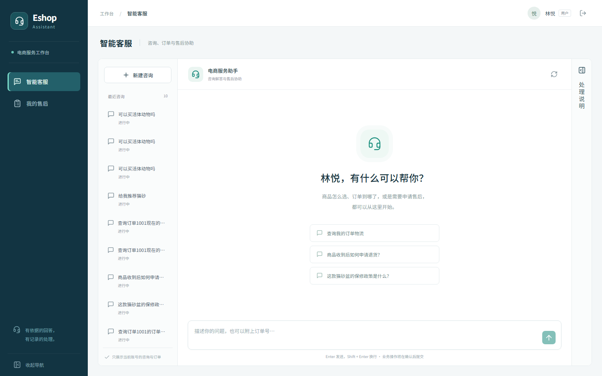

# Eshop Assistant

**English** | [简体中文](README.zh-CN.md)

An e-commerce support workspace built with FastAPI, LangGraph, and React. It connects evidence-backed answers, order lookup, human confirmation, after-sales review, and knowledge maintenance, with a timeline of business actions.

This project is intended for local demos and engineering practice. The UI and sample knowledge are primarily in Chinese. The logistics, warranty, and after-sales MCP services use local demo data; they do not connect to real shipping or payment providers.



## Features

| Workflow | Capabilities |
| --- | --- |
| Customer support | Streaming conversations, evidence citations, order selection, confirmation and cancellation of write actions, after-sales requests, unresolved-answer feedback |
| Support operations | Request queue, order details, review notes, status timeline, human tasks, linked conversations |
| Knowledge operations | Collect retrieval gaps, failed self-checks, and unresolved feedback; group questions, review answers, retry indexing, and publish knowledge |
| Knowledge management | Chunk preview and deduplication, ingestion, vector backfill, retrieval checks, human acceptance of knowledge mined from conversations |

More screenshots: [after-sales workspace](docs/screenshots/cases.png) · [knowledge operations](docs/screenshots/knowledge.png) · [knowledge base](docs/screenshots/kb.png).

## Stack and design

- **Application**: React 19, TypeScript, Vite; FastAPI, SQLAlchemy, MySQL.
- **Agent and retrieval**: LangGraph interrupt/resume, SQLite checkpoints, Milvus hybrid retrieval and reranking, asynchronous rolling summaries.
- **Evidence gating**: Route knowledge answers using retrieval confidence. Weak evidence leads to abstention or human assistance, and gaps feed the knowledge review workflow. This does not guarantee that model outputs are always correct.
- **Tool execution**: Validate arguments, require confirmation for write tools, inject server-owned identity, check order ownership, and record audits. Write tools are not automatically retried; business submissions use idempotency keys and content fingerprints to handle repeated requests.
- **Consistency**: Versioned after-sales updates detect concurrent changes and return HTTP 409 on conflict. Knowledge is published only after indexing succeeds, with retries for failures.
- **Access control**: Session authentication, CSRF checks, and order and conversation ownership checks.
- **Optional observability**: LangSmith traces, conversation correlation, and root-run token usage grouped by intent. Disabled by default.

See [architecture.md](docs/architecture.md) for components and request flows.

## First-time setup

Prerequisites: Python 3.12+, uv, Node.js 22 with npm, Docker Compose, and a running Docker Desktop instance. Run the following commands from the project root in PowerShell.

### 1. Install dependencies and configure services

```powershell
uv sync --python 3.12
if (!(Test-Path .env)) { Copy-Item .env.example .env }
npm --prefix frontend ci
```

Edit `.env` with working model-service settings. API keys in the example file are empty.

| Settings | Purpose |
| --- | --- |
| `CHAT_BASE_URL`, `CHAT_MODEL`, `CHAT_API_KEY` | Model-driven conversations and Agent calls |
| `EMBED_BASE_URL`, `EMBED_MODEL`, `EMBED_API_KEY` | Knowledge vectorization and vector retrieval |
| `RERANK_BASE_URL`, `RERANK_MODEL`, `RERANK_API_KEY` | Retrieval reranking |
| `DATABASE_URL` | Business database; defaults to MySQL on port 3307 |
| `MILVUS_URI`, `MILVUS_COLLECTION` | Defaults: `http://localhost:19531`, `eshop_knowledge` |
| `MCP_LOGISTICS_URL`, `MCP_AFTERSALES_URL` | Defaults: local ports 8111 and 8112, both at `/mcp` |

Browsing the workspace and demo business records does not require model keys. The complete AI question-answering flow requires chat, embedding, and reranking services, plus knowledge initialization.

### 2. Start infrastructure and seed demo data

```powershell
docker volume create eshop-assistant-mysql-data
docker volume create eshop-assistant-milvus-data
docker volume create eshop-assistant-milvus-etcd
docker volume create eshop-assistant-milvus-minio
docker compose up -d --wait --wait-timeout 180
uv run python -m scripts.init_demo
```

Compose uses named external volumes, which must exist before the first startup. Recreating an existing volume does not clear its data. Demo initialization preserves existing account passwords, orders, and processing records. Business data lives in MySQL; SQLite is used for checkpoints and isolated tests. Old SQLite demo records are not automatically imported into MySQL.

### 3. Initialize the knowledge base

After configuring the embedding service, run:

```powershell
uv run python -m scripts.build_kb
uv run python -m scripts.vectorize_kb
```

The first command chunks documents from `data/kb/` and writes pending records to the business database. The second embeds pending chunks and indexes them in Milvus. Reranking is used during retrieval, not by the vectorization script.

### 4. Build and launch the workspace

```powershell
npm --prefix frontend run build
uv run python -m scripts.dev
```

Open the [local workspace](http://127.0.0.1:8010). The launcher waits for Docker dependencies, then starts the logistics MCP service, after-sales MCP service, and API. Logs are written to `data/runtime-logs/`.

Ctrl+C stops only application processes started by this invocation. Docker and pre-existing processes remain running. Occupied MCP ports are reused without checking service identity; ensure ports 8111 and 8112 are not occupied by unrelated programs.

## Daily development

After initialization and the frontend build, start the application with:

```powershell
uv run python -m scripts.dev
```

The launcher does not install dependencies, initialize or migrate data, or build the frontend or knowledge base. Rebuild after frontend changes, or start the development server in another terminal:

```powershell
npm --prefix frontend run dev
```

Open the address printed by Vite. Requests to `/api` are proxied to port 8010. For individual service debugging, run each command in a separate terminal:

```powershell
uv run python -m mcp_servers.logistics_server
uv run python -m mcp_servers.aftersales_server
uv run uvicorn app.main:app --host 127.0.0.1 --port 8010
```

## Demo accounts and walkthrough

| Role | Email |
| --- | --- |
| Customer: 林悦 | `lin@eshop.demo` |
| Customer: 周然 | `zhou@eshop.demo` |
| Support agent: 陈曦 | `agent@eshop.demo` |

The initial demo password in `.env.example` is `123456`. Set `DEMO_PASSWORD` before the first initialization to change it; updating the setting does not reset existing passwords. Demo account shortcuts return the demo password to the browser and fill the login form. Set `DEMO_ACCOUNTS_ENABLED=false` to disable these shortcuts and password disclosure. These settings and default database credentials are intended for local demos only.

Suggested demo sequence:

1. Sign in as 林悦, select an order, confirm an after-sales request, and view its pending status.
2. Sign in as the support agent, inspect the request and order, add review notes, approve it, and record the outcome.
3. Sign in as 周然 and verify that 林悦's orders, conversations, and requests cannot be accessed.
4. With model and retrieval services configured, demonstrate citations, abstention, feedback collection, reviewed knowledge updates, and subsequent retrieval.

See [walkthrough.md](docs/walkthrough.md) for detailed steps.

## Verification and evaluation

```powershell
uv run python -m scripts.verify
npm --prefix frontend run build
```

`scripts.verify` runs a selected business regression suite covering identity isolation, CSRF, repeated and concurrent submissions, status conflicts, MCP ownership checks, knowledge publishing retries, and checkpoint recovery. It does not establish that the full test suite or real external-service integrations pass.

The full suite has known issues involving older API contracts, external-service dependencies, and asynchronous mocks. See [testing.md](docs/testing.md). Historical results recorded there are not results from the current run.

The RAG evaluation entry point is `scripts/eval_rag.py`, with data in `tests/data/rag_eval.jsonl` and format checks in `scripts/validate_rag_dataset.py`. Measure retrieval quality with Milvus and model services available; this README makes no fixed accuracy claim. Reports are written to the corresponding directories under `data/reports/`; reruns may overwrite previous reports.

## Optional: LangSmith

Configure `.env` and restart the API:

```dotenv
LANGSMITH_TRACING=true
LANGSMITH_API_KEY=your-langsmith-key
LANGSMITH_ENDPOINT=https://api.smith.langchain.com
LANGSMITH_PROJECT=eshop-assistant-local
LANGSMITH_WORKSPACE_ID=
LANGSMITH_HIDE_INPUTS=true
```

Use the endpoint for your account region and keep keys on the backend. Traces are correlated through `thread_id`. Inputs are hidden by default, but outputs may still contain business data. Cloud tracing verification requires valid credentials and a real graph invocation.

```powershell
uv run python -m scripts.cost_by_intent --days 7
```

The report reads root-run usage from the configured LangSmith project to avoid counting child runs twice.

## Repository layout and documentation

```text
app/api/         Authentication, conversation, order, after-sales, and knowledge APIs
app/core/        Business rules, retrieval, knowledge publishing, and observability
app/graph/       LangGraph state, routing, nodes, and recovery
app/db/          SQLAlchemy models and database sessions
app/tools/       Built-in tools, execution engine, and MCP client
mcp_servers/     Local logistics and after-sales adapters
frontend/src/   React pages, API client, and styles
data/kb/        Sample knowledge documents
scripts/        Initialization, development, regression, and evaluation scripts
tests/          Business regression, unit, and integration tests
```

- [Architecture and design](docs/architecture.md)
- [Test status and limitations](docs/testing.md)
- [Demo walkthrough](docs/walkthrough.md)
- [Scope and roadmap](docs/roadmap.md)
- [Changelog](CHANGELOG.md)

These supporting documents are currently primarily in Chinese.

## Current limitations

- A completed after-sales request represents completion of the local workflow, not a real payment refund.
- The application currently runs with one API worker. Concurrent checkpoint recovery across processes requires an additional shared conversation lock.
- MySQL and Milvus coordinate through stable chunk IDs and retry compensation, without a cross-database strongly consistent transaction.
- Model, embedding, reranking, cloud tracing, and MySQL end-to-end behavior require separate verification in the target environment.
