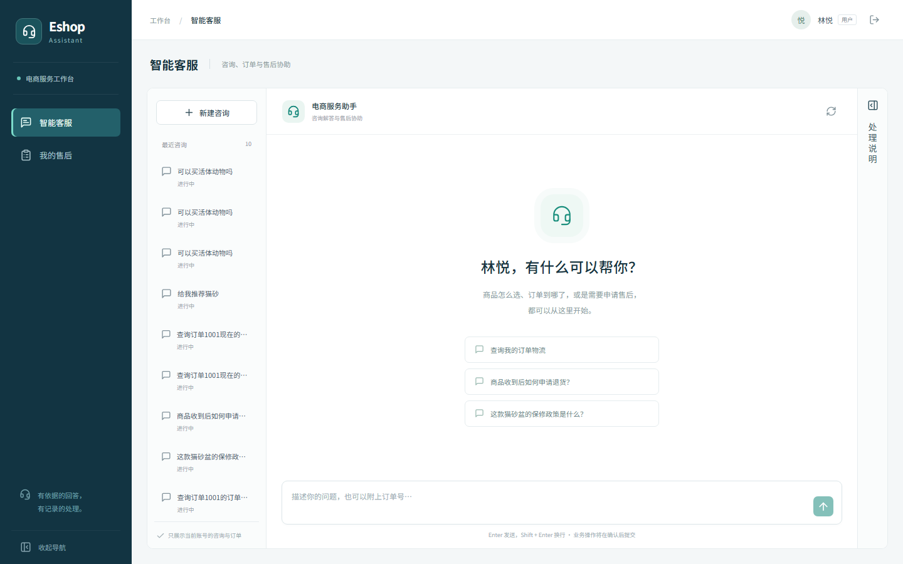

# Eshop Assistant

[English](README.md) | **简体中文**

基于 FastAPI、LangGraph 和 React 的电商客服工作台，覆盖知识问答、订单查询、人工确认、售后审核与知识补全。回答可追溯到检索证据，业务操作保留处理时间线。

本项目用于本地演示与工程实践，界面及示例知识以中文为主。物流、保修和售后 MCP 服务使用本地演示数据，未接入真实物流或支付渠道。



## 功能

| 使用场景 | 当前能力 |
| --- | --- |
| 用户咨询 | 流式会话、证据引用、订单选择、写操作确认与取消、售后申请、未解决反馈 |
| 客服处理 | 售后队列、订单详情、审核意见、状态时间线、人工待办、关联对话 |
| 知识运营 | 汇集检索不足、自评未过和未解决反馈，归并问题、审核答案、重试索引、发布知识 |
| 知识库管理 | 文档切块预览与查重、入库、向量补齐、检索自测、人工采纳对话挖掘结果 |

更多截图：[售后工作台](docs/screenshots/cases.png) · [知识运营](docs/screenshots/knowledge.png) · [知识库](docs/screenshots/kb.png)。

## 技术与关键设计

- **应用层**：React 19、TypeScript、Vite；FastAPI、SQLAlchemy、MySQL。
- **Agent 与检索**：LangGraph interrupt/resume、SQLite checkpoint、Milvus 混合检索与重排、异步滚动摘要。
- **证据门控**：知识回答依据检索证据置信度分流，证据不足时拒答或引导人工处理；缺口进入知识运营流程。这不保证模型输出永远正确。
- **工具执行**：统一校验参数、确认写操作、注入服务端身份、检查订单归属并记录审计。写工具不自动重试，业务提交使用幂等键与内容指纹处理重复请求。
- **业务一致性**：售后状态更新使用版本号检测并发冲突，冲突返回 409；知识索引完成后才发布，失败可重试。
- **访问控制**：会话认证、CSRF 校验，以及订单和会话归属检查。
- **可选观测**：LangSmith 追踪、按会话关联调用、按意图汇总根调用 token 用量，默认关闭。

架构与链路说明见 [architecture.md](docs/architecture.md)。

## 首次启动

需要 Python 3.12+、uv、Node.js 22（含 npm）、Docker Compose 和正在运行的 Docker Desktop。以下命令在项目根目录通过 PowerShell 执行。

### 1. 安装依赖并配置环境

```powershell
uv sync --python 3.12
if (!(Test-Path .env)) { Copy-Item .env.example .env }
npm --prefix frontend ci
```

编辑 `.env`，填写你可用的模型服务配置。示例文件中的 API key 为空。

| 配置 | 用途 |
| --- | --- |
| `CHAT_BASE_URL`、`CHAT_MODEL`、`CHAT_API_KEY` | 模型驱动的咨询与 Agent 调用 |
| `EMBED_BASE_URL`、`EMBED_MODEL`、`EMBED_API_KEY` | 知识向量化与向量检索 |
| `RERANK_BASE_URL`、`RERANK_MODEL`、`RERANK_API_KEY` | 检索结果重排 |
| `DATABASE_URL` | 业务数据库，默认 MySQL，端口 3307 |
| `MILVUS_URI`、`MILVUS_COLLECTION` | 默认 `http://localhost:19531`、`eshop_knowledge` |
| `MCP_LOGISTICS_URL`、`MCP_AFTERSALES_URL` | 默认本机 8111、8112 端口下的 `/mcp` |

仅浏览工作台和演示业务数据无需模型密钥；完整 AI 问答需配置聊天、嵌入与重排服务，并完成知识初始化。

### 2. 启动基础服务并初始化数据

```powershell
docker volume create eshop-assistant-mysql-data
docker volume create eshop-assistant-milvus-data
docker volume create eshop-assistant-milvus-etcd
docker volume create eshop-assistant-milvus-minio
docker compose up -d --wait --wait-timeout 180
uv run python -m scripts.init_demo
```

Compose 使用命名的外部卷，首次启动前必须创建。重复创建不会清空数据；演示初始化不会重置已有账号密码、订单或处理记录。业务数据使用 MySQL；SQLite 用于 checkpoint 和隔离测试，旧 SQLite 演示数据不会自动导入 MySQL。

### 3. 初始化知识库

配置好嵌入服务后执行：

```powershell
uv run python -m scripts.build_kb
uv run python -m scripts.vectorize_kb
```

前者将 `data/kb/` 文档切块写入业务库的待索引记录，后者生成向量并写入 Milvus。重排服务用于后续检索，不是向量化脚本的前置依赖。

### 4. 构建并启动工作台

```powershell
npm --prefix frontend run build
uv run python -m scripts.dev
```

打开 [本地工作台](http://127.0.0.1:8010)。启动器等待 Docker 依赖就绪，再启动物流 MCP、售后 MCP 和 API。日志位于 `data/runtime-logs/`。

Ctrl+C 仅停止本次启动的应用进程，Docker 和已有进程继续运行。启动器会复用已占用的 MCP 端口，但不核验对应服务身份；启动前应确保 8111、8112 未被无关程序占用。

## 日常开发

完成初始化与前端构建后，每次启动：

```powershell
uv run python -m scripts.dev
```

该命令不安装依赖、不初始化或迁移数据，也不构建前端和知识库。修改前端后重新构建，或另开终端使用开发服务器：

```powershell
npm --prefix frontend run dev
```

使用 Vite 输出的地址访问开发界面，`/api` 请求转发至 8010。需要独立调试时，可分别在三个终端启动：

```powershell
uv run python -m mcp_servers.logistics_server
uv run python -m mcp_servers.aftersales_server
uv run uvicorn app.main:app --host 127.0.0.1 --port 8010
```

## 演示账号与流程

| 身份 | 邮箱 |
| --- | --- |
| 用户林悦 | `lin@eshop.demo` |
| 用户周然 | `zhou@eshop.demo` |
| 客服陈曦 | `agent@eshop.demo` |

`.env.example` 的初始演示密码为 `123456`。首次初始化前可修改 `DEMO_PASSWORD`，已有账号密码不会随配置变化而重置。演示身份入口会向浏览器返回演示密码并自动填表；`DEMO_ACCOUNTS_ENABLED=false` 关闭该入口及密码返回。此配置及默认数据库口令仅适合本地演示。

建议按以下顺序演示：

1. 林悦选择订单、确认售后申请，在「我的售后」查看待审核状态。
2. 客服打开申请、核对订单、填写意见、批准并记录处理结果。
3. 周然登录，验证不能读取林悦的订单、会话和申请。
4. 模型与检索服务就绪后，演示证据引用、拒答、反馈归集、审核补全和检索生效。

详细步骤见 [walkthrough.md](docs/walkthrough.md)。

## 验证与评估

```powershell
uv run python -m scripts.verify
npm --prefix frontend run build
```

`scripts.verify` 运行选定的业务回归集，覆盖身份隔离、CSRF、重复与并发提交、状态冲突、MCP 归属检查、知识发布重试和 checkpoint 恢复等。它不代表全仓测试或真实外部服务的端到端验收。

全仓测试仍有旧接口契约、外部服务依赖和异步 mock 不匹配等已知问题；详见 [testing.md](docs/testing.md)。该文档记录的历史结果不代表本次运行结果。

RAG 评估入口为 `scripts/eval_rag.py`，数据集为 `tests/data/rag_eval.jsonl`，格式校验入口为 `scripts/validate_rag_dataset.py`。指标需在 Milvus 与模型服务就绪后实测，不在 README 中承诺固定准确率。评估报告默认输出至 `data/reports/` 下对应目录，重跑可能覆盖上次报告。

## 可选：LangSmith

在 `.env` 中配置后重启 API：

```dotenv
LANGSMITH_TRACING=true
LANGSMITH_API_KEY=your-langsmith-key
LANGSMITH_ENDPOINT=https://api.smith.langchain.com
LANGSMITH_PROJECT=eshop-assistant-local
LANGSMITH_WORKSPACE_ID=
LANGSMITH_HIDE_INPUTS=true
```

Endpoint 应与账号区域一致；密钥仅放在后端。追踪通过 `thread_id` 关联会话。默认隐藏输入，但输出仍可能包含业务信息。云端验收需有效密钥和真实图调用。

```powershell
uv run python -m scripts.cost_by_intent --days 7
```

该报表从配置的 LangSmith 项目读取根调用用量，避免重复累计子调用。

## 目录与文档

```text
app/api/         认证、会话、订单、售后及知识 API
app/core/        业务规则、检索、知识发布与观测
app/graph/       LangGraph 状态、路由、节点与恢复
app/db/          SQLAlchemy 模型与数据库会话
app/tools/       内置工具、统一执行器与 MCP 客户端
mcp_servers/     本地物流与售后适配服务
frontend/src/   React 页面、API 客户端与样式
data/kb/        示例知识文档
scripts/        初始化、开发启动、回归与评估脚本
tests/          业务回归、单元与集成测试
```

- [架构与设计](docs/architecture.md)
- [测试现状与限制](docs/testing.md)
- [演示步骤](docs/walkthrough.md)
- [范围与路线图](docs/roadmap.md)
- [变更记录](CHANGELOG.md)

上述补充文档目前以中文为主。

## 当前边界

- 售后「已处理」表示本地流程结束，不代表真实退款到账。
- 当前按单 API worker 运行；SQLite checkpoint 的跨进程并发恢复需要额外的共享会话锁。
- MySQL 与 Milvus 通过稳定块 ID 和重试补偿协作，不提供跨库强一致事务。
- 模型、嵌入、重排、云端追踪及 MySQL 端到端效果需要在目标环境独立验收。
