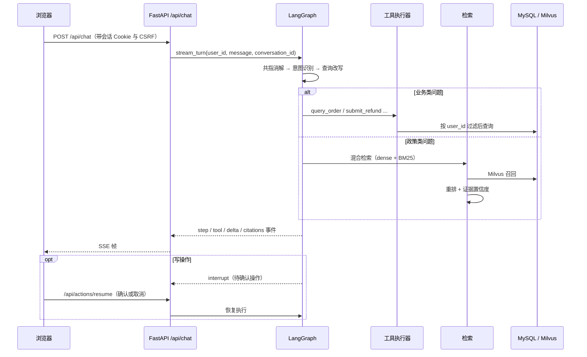

# 架构

## 组成

| 部分 | 职责 | 技术 |
| --- | --- | --- |
| 前端 | 四个页面：咨询、售后工作台、知识运营、知识库 | React 19 + TypeScript + Vite，构建产物由 API 直接托管 |
| API | 认证、会话、售后、知识审核、知识库管理 | FastAPI（8010），SSE 流式输出 |
| 图编排 | 意图识别 → 检索/工具 → 生成 → 用户确认 | LangGraph，checkpoint 落 SQLite |
| 工具层 | 五个内置工具 + 两个 MCP 服务 | 统一执行器，参数校验与归属校验在服务端 |
| 业务库 | 账号、会话、消息、售后单与事件、知识块、缺口池、审计 | MySQL 3307（SQLAlchemy async） |
| 向量库 | 知识块向量与 BM25 稀疏向量 | Milvus 19531 |
| MCP | 物流、售后两个只读服务 | 独立进程（8111 / 8112），只读本地快照 |

## 一次咨询的链路



置信度低于阈值时不生成答案，直接拒答并把问题写入缺口池。

## 知识从材料到可检索

```
data/kb/*.md
  → documents.build_chunks（按标题层级切块，标记表格与关键条款）
  → dualwrite.write_pending（MySQL knowledge_chunks，status=pending）
  → dualwrite.vectorize_pending（Milvus upsert，status=done）
  → review 审核通过的同一条管线（发布 = 入库 + 向量化 + 置为已发布）
```

任一步失败都停在 `pending`，页面顶部的“待向量化”与“双写一致性”就是拿这两个数比出来的。

## 关键决策

**ADR-1 证据不足就拒答。** 让模型在没证据时兜底，短期体验更好，但无法区分“不知道”和“编得像”。选择拒答，代价是召回差时用户会碰壁；被拒问题进缺口池，成为补知识的输入。

**ADR-2 写操作只执行一次，重放安全交给幂等键。** 执行器对写类工具不重试：超时后重放可能重复建单。由 `(user_id, idempotency_key)` 唯一约束加内容指纹保证“同键同内容返回原单、同键换内容报冲突”。

**ADR-3 业务库与向量库双写，用状态 + 重试换最终一致。** 不引入分布式事务：MySQL 写入标 `pending`，向量化成功再标 `done`，失败可重复补齐；代价是有一个短暂的不一致窗口，靠页面上的计数暴露出来而不是隐藏。

**ADR-4 checkpoint 用 SQLite，按单 worker 运行。** 会话恢复只需要单进程内的持久化；跨进程并发恢复需要共享锁，明确暂缓。

## 边界

- 单 API worker；不保证跨进程并发恢复。
- 两个 MCP 是本地适配器，不连真实物流或支付。
- 检索链路的真实模型、嵌入与 Milvus 端到端仍需外部配置，未验证项见 [testing.md](testing.md)。
