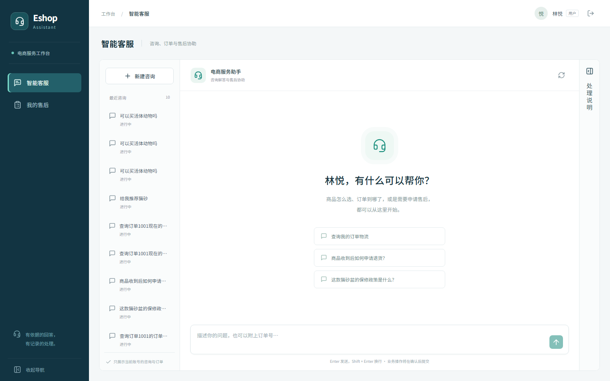
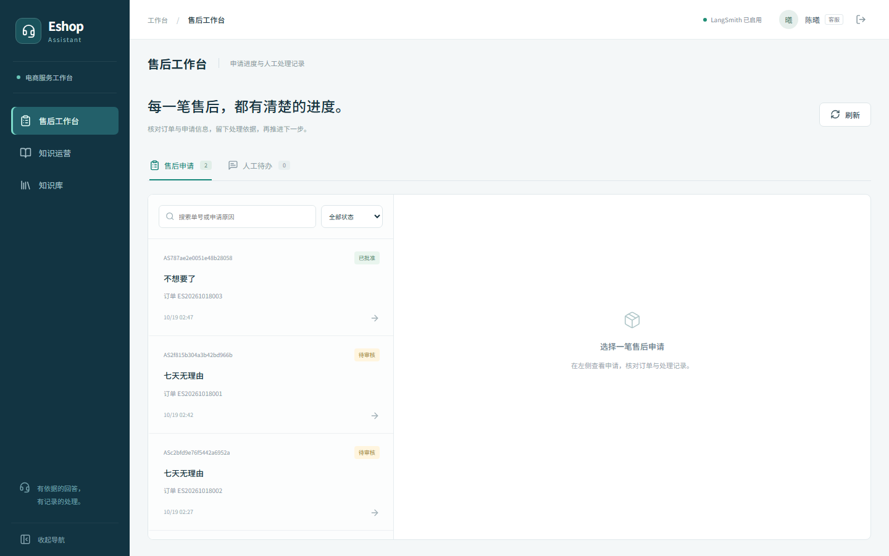
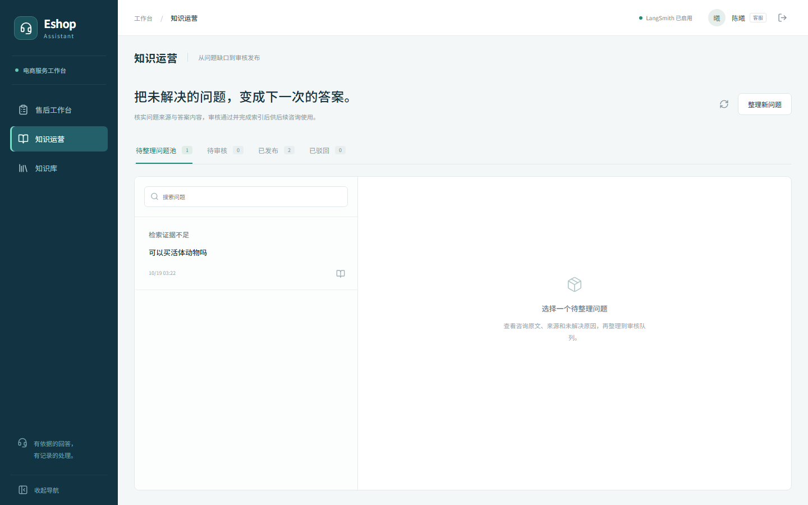
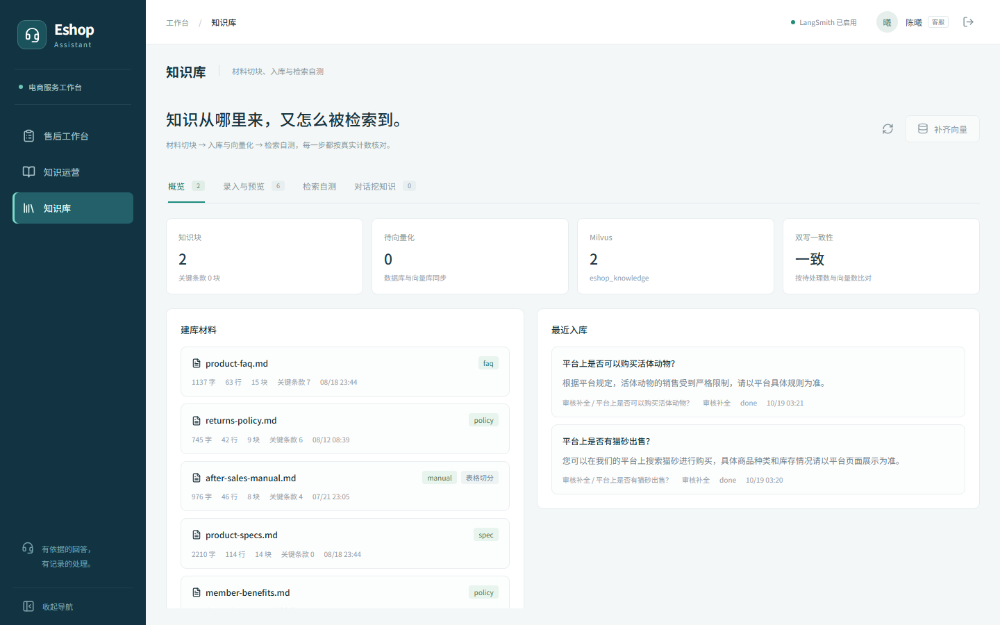

# 测试与验证

截至 2026-11-02。

## 怎么跑

```powershell
uv run python -m scripts.verify                     # 回归门，约 20 秒
uv run python -m pytest -q                          # 全仓
npm --prefix frontend run build                     # tsc 严格 + Vite
npm --prefix frontend run format:check              # Prettier
```

`scripts/verify` 只跑业务回归相关用例（`tests/portfolio` 与 `tests/core`、`tests/tools` 里的一部分），是判断当前版本是否健康的依据。

## 当前结果

| 项 | 结果 |
| --- | --- |
| `scripts/verify` | 84 passed |
| `tests/test_kb_api.py` + `tests/db` | 22 passed |
| 全仓 `pytest --collect-only` | 355 个用例 |
| 前端构建与格式检查 | 通过 |

## 已知失败

全仓跑会看到 50 余条失败与 4 个 error，属于早期用例，不随功能变化修：

- **401**：这些用例按旧契约直接请求业务接口，没有带登录态；现在接口默认要求会话。
- **连接失败**：依赖本机 MySQL 或 Milvus 的用例在容器未启动时连不上。
- **`'coroutine' object is not subscriptable`**：用例 mock 的是同步函数，实现里已经改成 `await`。

处理方式：要么补齐用例，要么删除。在那之前，回归结果以上表第一行为准。

## 手动验证

- 登录、读取本人订单、提交售后申请，在「我的售后」看到待审核。
- 客服看到同一申请，核对订单、填写意见、批准，事件出现在时间线。
- 五个内置工具导入注册成功；两个 MCP 服务动态发现 3 个工具且描述非空。
- 物流只读查询返回固定订单的物流事件；售后查询返回已批准状态。
- 知识发布用可控索引桩验证：首次失败保持待审，重试复用同一知识块，索引完成才发布。
- 会话恢复用真实 SQLite checkpointer 验证：关闭重开后仍可继续确认，重复恢复返回冲突，取消不创建工单。

## 已知问题与限制

- 单 API worker，跨进程并发恢复未实现，也不打算在本版本实现。
- 检索依赖 Milvus 与嵌入服务；未配置时页面显示不可用状态，不会伪造结果。
- 评估脚本只产出离线报告，未接入 CI；检索或切块变更后需要手动重跑。
- 演示账号与演示密码只用于本地，对外部署必须关闭 `DEMO_ACCOUNTS_ENABLED` 并更换数据库口令。
- LangSmith 云端 trace、真实模型与嵌入的完整 RAG 链路、MySQL 端到端流程仍需外部配置，尚未验证。

## 界面截图

以下为本机实际运行抓取的页面（1440×900，非设计稿）：

| 页面 | 截图 |
| --- | --- |
| 咨询（林悦） |  |
| 售后工作台（陈曦） |  |
| 知识运营 |  |
| 知识库 |  |

演示顺序见 [walkthrough.md](walkthrough.md)。
